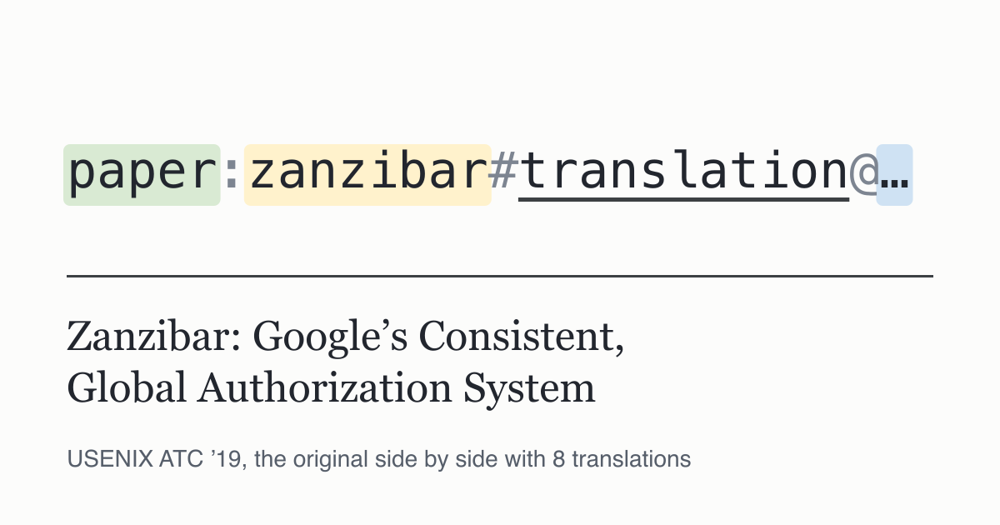

# zanzibar-paper

[](https://github.com/0-draft/zanzibar-paper/actions/workflows/ci.yml)
[](https://www.usenix.org/conference/atc19/presentation/pang)
[](#읽기)
[-565e6a)](LICENSE)

[English](README.md) | [日本語](README.ja.md) | [简体中文](README.zh-Hans.md) | [繁體中文](README.zh-Hant.md) | **한국어** | [Español](README.es.md) | [Français](README.fr.md) | [Deutsch](README.de.md) | [Português](README.pt-BR.md)

[](https://0-draft.github.io/zanzibar-paper/)

Zanzibar 논문을 원문과 나란히 놓고 읽는 사이트입니다. 왼쪽에 원문, 오른쪽에 번역문을 한 문단씩 나란히 배치했기 때문에, 확신이 서지 않는 문장 바로 옆에 항상 원문이 있습니다.

> Ruoming Pang, Ramón Cáceres, Mike Burrows 외. *Zanzibar: Google's Consistent, Global Authorization System.* USENIX ATC '19.

## 읽기

| 언어 | 페이지 |
| --- | --- |
| 日本語 | [Zanzibar: Google の一貫性を備えたグローバル認可システム](https://0-draft.github.io/zanzibar-paper/ja/) |
| 简体中文 | [Zanzibar：Google 的一致性全球授权系统](https://0-draft.github.io/zanzibar-paper/zh-Hans/) |
| 繁體中文 | [Zanzibar：Google 的一致性全球授權系統](https://0-draft.github.io/zanzibar-paper/zh-Hant/) |
| 한국어 | [Zanzibar: Google의 일관된 글로벌 인가 시스템](https://0-draft.github.io/zanzibar-paper/ko/) |
| Español | [Zanzibar: el sistema de autorización global y consistente de Google](https://0-draft.github.io/zanzibar-paper/es/) |
| Français | [Zanzibar : le système d’autorisation global et cohérent de Google](https://0-draft.github.io/zanzibar-paper/fr/) |
| Deutsch | [Zanzibar: Googles konsistentes, globales Autorisierungssystem](https://0-draft.github.io/zanzibar-paper/de/) |
| Português (Brasil) | [Zanzibar: o sistema de autorização global e consistente do Google](https://0-draft.github.io/zanzibar-paper/pt-BR/) |

모든 문단에 ¶ 링크가 있고, 언어를 바꿔도 읽던 문단에 그대로 머뭅니다. 두 열 중 어느 쪽이든 숨길 수 있습니다. 그림 2~5는 다시 그린 것이 아니라 PDF에서 잘라 낸 벡터 이미지입니다. 그림 1과 두 표는 텍스트이므로 네임스페이스 설정과 지연 시간 수치를 그대로 복사할 수 있습니다.

## 번역에 대해

비공식 번역이며 Google, USENIX, 저자와는 관계가 없습니다. 논문의 저작권은 © 2019 저자에게 있으며, [원문](https://www.usenix.org/conference/atc19/presentation/pang)은 USENIX에서 무료로 읽을 수 있습니다.

각 번역은 AI의 도움으로 초안을 만든 뒤, 별도의 검토 과정에서 영어 원문과 블록 단위로 대조해 의미가 어긋난 곳, 빠진 절, 바뀐 숫자를 찾았습니다. 예를 들어 한국어 번역은 14개 블록에서 *staleness*를 *latency*와 같은 단어로 옮기고 있었습니다. 그래도 오류가 남아 있을 수 있습니다. 발견하면 해당 문단의 ¶ 링크를 붙여 [issue를 열어](https://github.com/0-draft/zanzibar-paper/issues/new?labels=translation) 주세요.

## 원문에 충실하게 유지하는 방법

`content/en.yaml`은 PDF를 옮겨 적은 것으로, 원문의 오타("continously", "oustanding")까지 그대로 두고 `s2-2-p3`나 `tab-1` 같은 id를 가진 블록으로 나누어 두었습니다. `content/<lang>.yaml`의 번역은 같은 id 아래에 문자열만 담습니다. `pnpm validate`는 블록이 빠졌거나, 코드 스팬·수식·인용을 바꿨거나, CJK 문단을 영어로 남겨 둔 번역을 거부합니다. CI는 모든 pull request에서 이를 실행하며, 함께 Biome, `astro check`, Vitest, 일본어용 textlint, markdownlint, `pnpm audit`, 데스크톱과 모바일 뷰포트에서의 Playwright + axe, 오프라인 링크·프래그먼트 검사, actionlint와 zizmor도 실행합니다. 형식은 맞지만 다른 말을 하는 번역처럼 이런 검사로는 잡을 수 없는 문제는 Claude 리뷰가 각 diff를 읽어 확인합니다. Dependabot은 7일의 대기 기간을 둔 뒤 매주 의존성 업데이트를 제안합니다.

## 개발

```bash
pnpm install
pnpm dev                       # http://localhost:4321/zanzibar-paper/
pnpm validate                  # 원문과 모든 번역 검증
pnpm test                      # Vitest
pnpm build && pnpm test:e2e    # 빌드 결과에 Playwright + axe 실행
```

언어를 추가하려면 `src/i18n/langs.ts`에 등록하고 `src/i18n/ui.ts`에 UI 문자열을 추가한 다음, `node scripts/translation-skeleton.ts <code> > content/<code>.yaml`을 실행하고 `pnpm validate <code>`가 통과할 때까지 값을 번역합니다.

## 라이선스

코드는 [MIT License](LICENSE)를 따릅니다. 논문의 본문, 그림, 표는 저자에게 속하며 이 라이선스의 적용 대상이 아닙니다.
